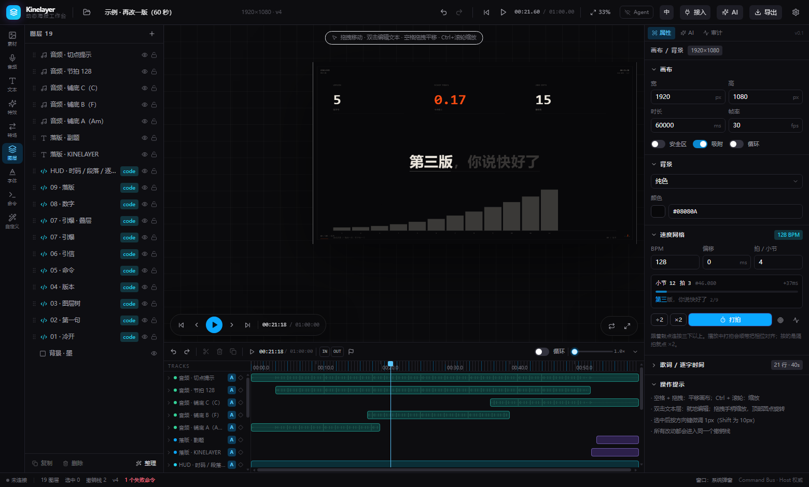

# Kinelayer

**简体中文** · [English](README.en.md)


**Kinelayer · 织层** —— 一个纯前端、可离线、命令驱动的动态海报编辑器。

**在线体验**：<https://knglokiko.github.io/Kinelayer/> · **源码**：<https://github.com/KNGLOKIKO/Kinelayer>

不做「拖拽拼图」，做的是「用一条命令总线把人类操作、网页内 AI、外部 Agent、独立图层窗口
统一成同一件事」。所有能力都注册在一张表里：人点按钮、AI 调工具、Agent 走 MCP，
最终落到总线上的都是同一条结构化 `Command`。

```
npm install
npm run dev          # http://localhost:5273
```



---

## 五条铁律，以及它们落在哪

| # | 铁律                        | 代码位置                                                                                   | 怎么验证                                                                 |
| - | ------------------------- | -------------------------------------------------------------------------------------- | -------------------------------------------------------------------- |
| 1 | 一切修改都是一条 `Command`，走同一条总线 | `src/core/commandBus.ts`、`src/core/registry.ts`                                        | 设置 → 命令面板：任意命令都能手输 payload 执行；审计面板里能看到来源（user / ai / agent / window） |
| 2 | 主窗口是唯一权威：唯一执行、唯一撤销栈、唯一主时钟 | `EditorApp.tsx`（rAF 主时钟）、`temporal.ts`、`commandBus.ts`                                 | 打开图层窗口后，撤销按钮只存在于主窗口                                                  |
| 3 | 图层窗口是只读镜像：只发请求，等广播        | `src/windows/client.ts`、`LayerMirror.tsx`                                              | 断网/关闭 Host，镜像立刻显示「已断开」                                               |
| 4 | 预览与导出共用同一套几何与渲染           | `renderScene.ts` + `geometry.ts`，被 `exporters.ts` 与镜像我复用                               | 同一帧导出 PNG 与屏幕像素一致                                                    |
| 5 | 工具 schema 由命令注册表自动生成      | `registry.ts#buildToolSchemas` → `ai/client.ts`（OpenAI）、`agent-bridge/src/mcp.js`（MCP） | 加一条命令，重载页面，AI 与 MCP 的工具列表自动多一项                                       |

---

## 目录结构与模块职责

```
Kinelayer/
├─ index.html                  启动期致命错误兜底（模块崩了也能看到人话）
├─ src/
│  ├─ core/                    ★ 唯一的真相层：数据、命令、历史
│  │  ├─ types.ts              数据模型：Project / 5 种 Layer / 动画 / 绑定 / 资源
│  │  ├─ schemas.ts            共享 zod 片段：颜色、缓动、图层 patch、动画…
│  │  ├─ registry.ts           命令注册表 + tool schema 生成（OpenAI / MCP 共用）
│  │  ├─ commandBus.ts         执行管线：校验 → 乐观锁 → dryRun → immer → 撤销点 → 广播 → 审计
│  │  ├─ temporal.ts           自研撤销栈：immer patches / inverse patches / 700ms 合并
│  │  ├─ store.ts              Zustand 三段式：project（存盘）/ ui / runtime（都不存盘）
│  │  ├─ defaults.ts           工厂 + normalizeProject（读宽容、写严格）+ 演示项目
│  │  ├─ commands/*.ts         84 条命令，按领域分文件（图层/文本/代码/背景/项目/资源/字体/时间轴/动画/选择/历史/窗口/导出/查询/AI/自定义/批处理）
│  │  ├─ customCommands.ts     【v2.7】宏的纯逻辑：占位符替换、参数收口、保存前校验、禁区命令、展开步骤
│  │  ├─ bundle.ts             工程包（.kly）：ZIP 打包/解包、逐文件 sha256、五道解压闸门
│  │  ├─ importPipeline.ts     【v2.5】导入管线的纯函数部分：嗅探 → 预检报告 → 映射成图层/轨道
│  │  ├─ aiScene.ts            【v2.5】`scene.ai.json`：给 Agent 的语义投影（秒制、无 base64、代码摘要）
│  │  └─ summary.ts            给 AI 的项目摘要（不含 base64，代码截断）
│  ├─ render/                  ★ 渲染层：纯函数，不知道 React 的存在
│  │  ├─ renderScene.ts        渲染单入口：预览 / PNG / WebM / 镜像 全走这里
│  │  ├─ geometry.ts           坐标系、命中测试、fitViewport、吸附
│  │  ├─ animation.ts          表达式编译、噪声、预设采样、三槽位合成 + 轨道覆盖
│  │  ├─ keyframes.ts          【v2】关键帧求值：evaluateTrack / applyTracks / cubic-bezier
│  │  ├─ text.ts               手工断行（CJK 按字 / 拉丁按词）、渐变字、字距
│  │  ├─ codeEngine.ts         canvas2d / glsl / html 三引擎 + 沙箱 + 熔断 + 信号总线
│  │  ├─ assets.ts             图片/视频资源池（IndexedDB → ImageBitmap/VideoElement）
│  │  ├─ htmlRaster.ts         HTML 层导出：SVG foreignObject 栅格化
│  │  ├─ exporters.ts          PNG / WebM（手动推帧）/ JSON
│  │  └─ thumbnail.ts          工程缩略图（长边 480；首帧全单色时退到 0.5s 重拍）
│  ├─ persist/                 ★ 持久化：工程本体 + 索引 + 资源 + 偏好、两代旧库迁移、本地字体
│  ├─ windows/                 ★ 多窗口：协议、Host、Client、镜像 UI、图层时间轴、独立页入口
│  ├─ ai/                      ★ AI：OpenAI 兼容客户端、加密配置、演示 Agent、桥接客户端
│  ├─ ui/                      舞台、时间轴、属性面板、图层面板、AI 面板、对话框
│  │  ├─ Launcher.tsx          启动页：page（独立视图）/ overlay（编辑器内 Ctrl+O）两种形态
│  │  ├─ LauncherPage.tsx      路由 `/` 的入口：只挂启动页与 Toast，不挂 Host
│  │  ├─ NewProjectDialog.tsx  新建项目：名称 / 预设 / 宽高 + 单位换算 / 时长 / 帧率 / 背景
│  │  ├─ routes.ts             `?view=editor|layer|launcher` 的 URL 构造与跳转
│  │  ├─ layout.ts             响应式三档（wide ≥1440 / mid ≥1080 / narrow），rAF 节流
│  │  ├─ importFlow.ts         导入状态机：选文件 → 预检 → 报告 → 确认 → 写库（成功后关覆盖层/跳编辑器）
│  │  ├─ ImportReportDialog.tsx 导入预检报告：格式、可编辑程度、图层统计、降级说明、缺失资源
│  │  └─ CustomCommands.tsx    【v2.7】自定义命令：步骤编辑器 + 参数表单（按 id 重挂，不用 effect 同步表单）
│  ├─ app/services.ts          把「副作用能力」注入命令层的服务表
│  ├─ EditorApp.tsx            三栏布局 + 引导 + 主时钟 + 自动保存 + 快捷键 + 窄屏抽屉
│  └─ main.tsx                 注册命令 → 注入服务 → 按 URL 分流主窗口/图层窗口
├─ agent-bridge/               ★ 本机桥接（Node 18+，独立依赖）
│  ├─ src/bridge.js            WS + HTTP 中继（127.0.0.1:2718，令牌鉴权）
│  ├─ src/mcp.js               MCP stdio 服务端：工具从 manifest 动态生成
│  └─ test/e2e.mjs             16 项端到端自检（假 Host + 真 MCP 客户端）
├─ scripts/                    ★ 端到端自检（headless Edge + CDP，需 dev server 跑在 5273）
│  ├─ _cdp.mjs                 公共壳：起浏览器、连 CDP、waitFor/截图/开新标签、结果收集
│  ├─ v2-check.mjs             17 项 · 关键帧与时间轴
│  ├─ rename-check.mjs         21 项 · 品牌迁移与格式迁移
│  ├─ multi-project-check.mjs  32 项 · 多工程、索引、旧单工程迁移
│  ├─ agent-panel-check.mjs    16 项 · 桌面 Agent 提示词面板
│  ├─ bundle-check.mjs         20 项 · .kly 真下载/真导入/敌意包拒绝
│  ├─ launcher-check.mjs       22 项 · 启动页路由/新建对话框/单位换算/缩略图/删除/英文模式
│  ├─ ai-check.mjs             34 项 · v2.5a 导入预检/降级映射/scene.ai.json 往返
│  ├─ remotion-check.mjs       37 项 · v2.5b Remotion 静态解析/remotion-component/kit 导出
│  ├─ html-check.mjs           43 项 · v2.5c HTML/GSAP 静态解析/postMessage 时间同步/origin 元信息
│  ├─ import-edit-check.mjs    30 项 · v2.6 导入之后：sourceRef/缺资源总账/asset.assign/来源区块
│  ├─ custom-check.mjs         39 项 · v2.7 自定义命令：存前校验/原子执行/参数类型/失败回滚/持久化/双语
│  ├─ online-smoke.mjs         31 项 · 对线上 GitHub Pages 部署的冒烟（不需 dev server）
│  └─ push-via-api.mjs         推送兜底：github.com 这一跳被网络策略掐掉时，改走 Git Data REST API（只推已跟踪文件）
└─ docs/
   ├─ 00-reference-notes.md    参考项目提取报告（第十四章）
   ├─ 01-known-limitations.md  已知限制与扩展点
   ├─ 02-bundle-format.md      工程包格式（.kly = ZIP）规范与敌意输入闸门
   ├─ 03-agent-integration.md  Agent 接入说明（中英双份，.en.md 为英文版）
   ├─ 04-code-video-integration.md  AI 代码视频：Remotion 静态解析与 remotion-kit 导出
   ├─ 05-html-gsap-import.md    HTML/GSAP 片段：DOM 结构提取、iframe 时间同步、origin 元信息
   ├─ 06-after-import.md        导入之后：缺资源的四种状态、来源溯源、asset.assign 补回
   └─ 07-custom-commands.md     自定义命令：为什么不做 DSL、{{x}} 两种语义、原子执行、禁区命令、跟人不跟工程
```

**分层规矩**：`ui/` 不能直接改 `project`；`render/` 不能 import `store`；
`persist/` 是最底层（不 import `store` / `ui`），命令层可以直接用它；
`core/commands/` 不能 import `ui/`。副作用（导出、开窗、读文件）统一走 `services.ts` 注入。

---

## 命令一览（84 条）

| 分类  | 条数 | 代表命令                                                                                                                                                                                                                          |
| --- | -- | ----------------------------------------------------------------------------------------------------------------------------------------------------------------------------------------------------------------------------- |
| 图层  | 13 | `layer.create` `layer.update` `layer.delete` `layer.duplicate` `layer.reorder` `layer.align` `layer.rename` `layer.fixAll` `layer.setVisible` `layer.setLocked` `layer.setBlendMode` `layer.setAnimation` `layer.setBindings` |
| 文本  | 3  | `text.setContent` `text.setStyle` `text.fitBox`                                                                                                                                                                               |
| 代码  | 4  | `code.setSource` `code.setEngine` `code.setParams` `code.resetRuntime`                                                                                                                                                        |
| 背景  | 2  | `background.set` `background.setCode`                                                                                                                                                                                         |
| 画布  | 3  | `canvas.resize` `canvas.setDuration` `canvas.setFps`                                                                                                                                                                          |
| 项目  | 10 | `project.new` `project.load` `project.create` `project.open` `project.rename` `project.duplicate` `project.deleteLocal` `project.listRecent` `project.exportBundle` `project.importBundle` |
| 资源  | 4  | `asset.import` `asset.place` `asset.assign` `asset.remove`                                                                                                                                                                    |
| 字体  | 3  | `font.register` `font.load` `font.remove`                                                                                                                                                                                     |
| 时间轴 | 5  | `timeline.play` `timeline.pause` `timeline.seek` `timeline.setLayerTiming` `timeline.setLoop`                                                                                                                                 |
| 动画  | 8  | `animation.setKeyframe` `animation.removeKeyframe` `animation.moveKeyframes` `animation.setEasing` `animation.setKeyframeValue` `animation.clearTrack` `animation.setAutoKeyframe` `animation.applyPreset`                     |
| 选择  | 4  | `selection.set` `selection.toggle` `selection.add` `selection.clear`                                                                                                                                                          |
| 历史  | 3  | `history.undo` `history.redo` `history.clear`                                                                                                                                                                                 |
| 窗口  | 4  | `window.openLayer` `window.closeLayer` `window.focusLayer` `window.setMode`                                                                                                                                                   |
| 导出  | 4  | `export.png` `export.webm` `export.json` `export.commands`                                                                                                                                                                    |
| 查询  | 4  | `query.project` `query.layer` `query.registry` `query.capture`                                                                                                                                                                |
| AI  | 5  | `ai.inspectImport` `ai.importProject` `ai.exportProject` `ai.queryCodeLayer` `ai.exportRemotionKit`                                                                                                                                    |
| 自定义 | 4  | `custom.list` `custom.define` `custom.remove` `custom.run`（宏：一串已有命令 + 参数，存独立 IndexedDB）                                                                                                                                                |
| 批处理 | 1  | `command.batch`（多条命令合成一个撤销点，失败原子回滚）                                                                                                                                                                                           |

每条命令都自带：zod schema、中文描述、可直接跑的 `example`、
以及 `mutating / dangerous / undoable / coalesce / asyncHandler / resetsHistory` 等元信息。

---

## v2 · 关键帧

v1 只有「入场 / 退场 / 强调」三个预设槽位，能做出生硬的淡入淡出，做不出真正的动效。
v2 在它上面加了**属性轨道**，而预设变成「一键生成关键帧」的语法糖——生成完就是普通轨道，
运行时没有第二套动画系统。

| 概念 | 说明 |
| --- | --- |
| `AnimatableProperty` | `x` `y` `width` `height` `rotation` `opacity` `fontSize` `letterSpacing`。准入标准只有一条：值必须能由 `(keyframes, localTime)` 唯一算出 |
| `Keyframe.time` | **相对图层 `inPoint` 的毫秒数**，绝不存绝对时间。整段图层挪位时关键帧自动跟着走 |
| `EasingSpec` | 复用既有缓动名，或 `cubic-bezier` 自定义曲线（与 CSS 同义，牛顿迭代 + 二分求解） |
| 求值优先级 | 基础属性 → 预设槽位（整段修饰）→ **轨道（绝对定点，赢）** → 表达式绑定 |
| 自动关键帧 | 开关打开后，改动**已有轨道**的属性会在当前播放头自动落点。实现在命令层，所以人、AI、Agent 行为完全一致 |

用法：时间轴上每个图层左侧的 `A` 是自动关键帧开关，菱形按钮是预设菜单；点图层名前的箭头
展开属性轨道，轨道右侧的菱形「在播放头打点」，拖菱形整体平移（松手才提交，一次拖动只留一个撤销点），
`Shift` 点可多选后统一改缓动或删除。缩短时长导致越界的图层会在时间轴上标红，点顶部的
「N 个图层越界 · 修复」一次收回。

工程文件带 `schemaVersion`（当前为 2）。读入时 v1 文件会被 `normalizeAnimation` 平滑迁移，
写出永远是当前版本——读宽容、写严格。

---

## v3 · 工作台：多工程、工程包、三档屏幕、图层时间轴

v2 之前一次只能开一个工程，关掉标签页就等于把旧的忘了。v3 补的是「工作台」这一层。

### 启动页（工程库）

访问根路径就是启动页，`Ctrl/Cmd + O` 在编辑器里打开同一个库（覆盖层，不重新加载）。

| 路由 | 视图 |
| --- | --- |
| `/` | 启动页（独立视图，**不是 Host**，只读索引 + 发命令） |
| `/?view=editor&projectId=xxx` | 编辑器（唯一 Host） |
| `/?view=layer&layerId=…&host=…` | 图层独立窗口（纯 Client） |
| `/?view=launcher` | 编辑器 + 工程库覆盖层（历史深链） |

启动页**从不渲染编辑器** —— 那会同时存在两个 Host（主时钟、撤销栈各一份）。点「打开」只做两件事：
写 `lastProjectId`，然后 `location` 跳进 `?view=editor&projectId=…`。三个视图分开打包，
列工程不需要先把 CodeMirror 和渲染引擎拉下来。

左栏新建：空白项目（1080×1440 / 5s / 30fps）、自定义尺寸、四个预设（海报 / 横幅 / 方形 / 竖屏）。
右栏最近项目（最多 12 张，按更新时间降序），悬停出「打开 / 重命名 / 导出工程包 / 删除」，
右上角「打开本地 .kly 文件」。空状态明确告诉你从左边新建。

**新建对话框**：项目名（≤60）、预设填充、宽高（40–8000px）、时长（0.5–600s，0.1 步进）、
帧率（24/25/30/60）、背景色。宽高支持 **px / mm / cm / in** 四种单位，按 96dpi 换算
（1mm = 96/25.4 px），切单位时数字跟着换算、物理尺寸不变；**数据层永远只存 px**。
创建后直接进编辑器，并且当场写一次缩略图 —— 否则回到工程库就是一张空白卡。

删除当前工程时会先 `detach`：自动保存从此跳过它，否则定时器一响就把刚删的工程写回来。

### 工程包 `.kly` = 真 ZIP

`Ctrl/Cmd + S` 导出的 `.kly` 是一个 ZIP：`manifest.json` + `project.json` +
`assets/`（图片视频原文件）+ `fonts/`（只含用户上传的字体），逐文件带 sha256。
资源不再是 base64，所以工程包能真的带走素材，换台机器打开图片还在。

读包时假定包是敌意的：条目数 / 单文件大小 / 总大小 / 压缩比 / 路径穿越五道闸门
全部在 inflate **之前**判定。导入会换新 id，不覆盖本机同名工程；字体缺失降级到系统字体，
资源缺失才报错。完整规范见 [工程包格式](docs/02-bundle-format.md)。

老备份不会作废：`looksLikeZip()` 只看前两字节，是 `PK` 就走工程包，否则走旧的
`project.load`（v1 JSON 外壳、更早的裸 `Project` JSON 都认）。

### 响应式三档

| 档位 | 宽度 | 布局 |
| --- | --- | --- |
| `wide` | ≥ 1440 | 左 268 + 舞台 + 右 318，全套文字标签 |
| `mid` | ≥ 1080 | 面板收窄到 232 / 288，顶栏隐藏副标题 |
| `narrow` | < 1080 | 两个面板变**抽屉**（覆盖层，不挤压舞台），底栏胶囊开关面板 / 时间轴 / 检查器；顶栏只留图标 |

阈值在 `src/ui/layout.ts` 的 `WIDE_MIN` / `MID_MIN`，`useLayoutTier()` 用 rAF 节流监听
`resize`，不给每次拖动都跑一轮 React 渲染。

### 图层独立窗口里的时间轴

图层窗口（`?layer=<id>`）原来只能看属性，现在中间多了一条自己的时间轴：
in/out 之外压暗、每条属性轨道一条细线、关键帧按属性配色画成菱形、播放头红线，
还能跳到上一个/下一个关键帧。

它是**只读镜像**：拖动只发 `{ kind: 'command', command: 'timeline.seek' }` 给 Host，
落点由 Host 决定并广播回来。seek 节流到 80ms（保留最后一次落点），
所以拖着划过整条时间轴也只会打出一串稀疏的 seek，不会把消息队列灌满。

---

## v2.5 · AI 代码视频：导入与语义导出（阶段 A）

这一阶段的定位是「让 AI 生成的工程进得来、出得去」，三条原则：

1. **代码是一等公民图层**。导入不了的东西不硬塞成图片：能映射成文本/图片/轨道的就映射，
   映射不了又确实要画的（矩形、圆、路径）降级成 canvas2d 代码层 —— 位置/尺寸/透明度照样能打关键帧，
   只是内部不可逐元素编辑。
2. **导入先预检，再落库**。`ai.inspectImport` 是纯函数，给字节或文本就能算出「会得到什么」：
   格式、可编辑程度、图层/代码层/轨道/关键帧计数、每一处降级的原因、缺失的资源。
   用户确认后 `ai.importProject` 才写库（它内部会再跑一次同样的预检，Agent 跳过第一步也拿得到报告）。
3. **导出带「工程语义层」**。`ai.exportProject` 产出 `scene.ai.json`：时间统一秒、缓动压成字符串、
   代码层给 `codeSummary` + `codeLines` + `codeBytes`，**不含任何 base64**。

### 判据：什么被映射，什么被降级

| 输入 | 结果 | 可编辑程度 |
| --- | --- | --- |
| `.kly` 工程包 | 走 `project.importBundle`（校验 sha256） | 100 |
| 原生 `project.json` | `normalizeProject` 精确还原（认的是 blendMode/animation/inPoint 这套原生字段，不是 `layers[0].type`） | 100 |
| `scene.ai.json` | 摊平回场景形状再走同一条映射管线 | 96 起 |
| 场景 JSON（Rendervid / cadence 风格） | 文本→文本层、图片视频→媒体层、坐标/尺寸/时序→图层属性、`tracks`→属性轨道；矩形/圆→canvas2d 代码层 | 70–96 |
| HTML / GSAP 片段 | 静态 DOM 解析：绝对定位的文本/图片/容器→原生图层、CSS class 规则→字号颜色、GSAP timeline→属性轨道；流式布局的元素整块留成 `html` 代码层 | 20–95 |
| 图片 / 视频 | 建画布 + 媒体层 | 30 |
| Remotion 工程 ZIP | 静态 AST 解析：`<Sequence>` 的时间、文字/图片/容器→原生图层、`interpolate`/`spring`→属性轨道；自定义组件整块留成 `remotion-component` 代码层 | 25–90 |

`scene.ai.json` 能原路导回（34 项自检里有一组往返用例）：导出的语义投影再导入，
图层数、文字内容、轨道与关键帧都能对上；媒体层因为不带二进制，只会剩资源名 ——
这一点在预检报告里明写，不靠用户自己发现。

Remotion 的边界更硬一点：**只读源码、不执行**，也只认结构（JSX 元素、字面量、常量表、
`interpolate`/`spring` 的参数）。`useContext` 里的数据、`fetch` 的返回、循环里算出来的坐标一律不猜 ——
猜错会让用户以为导进来的是原片。拆不出来的组件整块保留，双击是**只读**源码查看器，
时间轴上只画静态首帧卡片。细节见 [代码视频集成](docs/04-code-video-integration.md)。

### 每一层都记得自己从哪来

`LayerOrigin = { generator, sourceFormat, sourceBundle, importedAt }`，不参与渲染，
只服务三件事：图层树上的来源徽标（`AI` / `导入` + 悬浮看详情）、导入降级决策的审计、以及「这层为什么改不了」。

### 相关命令

```
ai.inspectImport   { stageId | text, name?, format? }        → { report, importable }
ai.importProject   { stageId | text, mode? }                 → { projectId, format, fidelity, counts… }
ai.exportProject   { projectId?, includeCode?, download? }   → { filename, text, bytes, layers… }
ai.queryCodeLayer  { layerId?, includeCode? }                → 代码层摘要（不拉整份场景）
ai.exportRemotionKit { projectId?, download? }               → remotion-kit ZIP（可 npx remotion render）
```

### remotion-kit：把代码带出去出片

Kinelayer 不在浏览器里跑渲染管线，所以 `remotion-component` 层只能静态预览。
想拿到成片，用 `ai.exportRemotionKit` 导出一份外部工程：

```
remotion-kit/
├── package.json      只有 remotion / react / react-dom / @remotion/cli
├── src/index.ts      registerRoot
├── src/Root.tsx      每个 remotion 层一个 <Composition>
├── src/layers/<Name>/entry.tsx   该层组件源码（缺 default export 时补一行）
├── src/original/**   原工程源码树（相对 import 靠它才不断）
├── public/assets/**  引用的媒体
└── README.md         npx remotion render 的命令
```

```bash
npm install && npx remotion render src/index.ts kly-01 out/kly-01.mp4
```

### HTML / GSAP：留下来的是「剩下那部分」

一个 `.html` 文件进来，先按绝对定位拆一遍：`position:absolute` 且写了 `left/top` 的
文本/图片/容器变成原生图层，`<style>` 里的 class 规则（字号、颜色、圆角）跟着读进来，
`<script>` 里的 `gsap.to / from / fromTo / timeline` 变成原生关键帧。

拆不动的（普通流、flex、canvas、svg）不会硬猜位置 —— 整块留成一个 `html` 代码层，
报告里写明「流式布局的 N 个元素留在代码层」。这条边界写在
[docs/05-html-gsap-import.md](docs/05-html-gsap-import.md) 第三章。

那个 `html` 代码层在编辑态是一个 `sandbox="allow-scripts"` 的 iframe，
里面注入了桥接脚本：**一加载就冻结动画，跟着主时间轴 seek**，不会自己按真实时间跑。
它还会量出自己的内容包围盒上报回来 —— sandbox iframe 的白底在 Chrome 里去不掉
（`html/body` 写 `transparent` 也白，实测四个变体），只能让背景色等于画布底色、
再把 iframe 收缩到真有内容的那块，不然它会把整张画布连同一堆原生图层糊掉。

报告关掉之后缺资源的图只剩一块灰占位，所以每个没落地的图都会在 `origin.sourceRef`
留下原始地址；图层树上有「N 层缺资源 · 定位」的总账（点一下全选），Inspector 的
**来源** 区块负责把资源补回去（`asset.assign`，几何与关键帧一律不动），
指向同一地址的多层会一起补好。细节见 [docs/06-after-import.md](docs/06-after-import.md)。

---

## v2.7 · 自定义命令

一条命令只干一件事，可真实动作是「做一张标题卡要三步」。于是有了自定义命令：
**一串已有命令 + 一组参数**，用户和 AI 都能建、都能跑。

不做 DSL 是刻意的。宏的每一步就是一条注册表命令（`type` + `payload`），
参数用 `{{key}}` 在 payload 里占位。这样新加一条命令，宏能用的动作自动多一个，
不需要改宏系统的任何代码；AI 也不用先学一门语言，它本来就会写 JSON 命令。

```jsonc
// 整个值就是一个占位符 → 保留原类型（传 7500 得到的还是数字，不会被 z.number() 拒收）
{ "duration": "{{ms}}" }
// 嵌在字符串里 → 拼接
{ "text": "标题-{{tag}}" }
```

**一条宏 = 一次原子批处理**：全部成功才落盘，任一步失败整体回滚，撤销一次就全退。
这条语义不新写，直接复用了 `command.batch`（失败回滚、合并撤销点、逐条审计都已经在里面）。

**存之前校验，不是跑之前**：命令是否存在、payload 是否符合该命令的 schema、
占位符有没有声明、有没有踩禁区命令 —— 全在保存那一刻挑出来并指到「第几步」。
否则就是「保存成功但永远失败」，用户根本不知道该改哪儿。
唯一例外是「字段值本身来自占位符」的情况，静态量不出来，降级成 warning。

禁区命令（编辑器下拉里直接过滤掉）：`command.batch`（套娃）、`custom.*`（递归）、
`history.*`（拆自己的地板）、`project.*`（换文档会清掉撤销历史）。

**宏跟人不跟工程**：存在独立的 IndexedDB store（DB v3 的 `commands`）里，不进 `.kly`。
在 A 工程写的「做标题卡」，B 工程也该能用。

界面上左栏多一个「自定义」页签：一条宏一张卡片（名字、`AI`/`我` 徽标、几步几参、跑过几次、
上次错在哪），一级按钮是运行 / 编辑 / 删除。有参数的宏点运行会先弹参数表单 ——
不问就按默认值跑，等于替用户做决定。编辑器里挑命令、改 payload、按光标位置插入参数。

AI 侧四条命令：`custom.list` / `custom.define` / `custom.run` / `custom.remove`，
`custom.run` 支持 `dryRun`（只回报「如果跑会跑哪些步骤」，真的什么都不改）。
宏的 `author` 由调用来源推断，所以「这条是谁建的」是记录在案的，不是猜的。

顺手还修了两个老 bug：`canvas.setDuration` 每次都在副作用闭包里读已被 immer 回收的 draft
（画面改了、命令却返回失败，控制台每改一次时长多一条 unhandled rejection）；
批处理遇到抛异常的命令时回滚代码执行不到，「原子」变成「前两步已提交」。
细节见 [docs/07-custom-commands.md](docs/07-custom-commands.md)。

---

## 快捷键

| 操作            | 快捷键                                     |
| ------------- | --------------------------------------- |
| 撤销 / 重做       | `Ctrl/Cmd + Z` / `Ctrl/Cmd + Shift + Z` |
| 复制选中图层        | `Ctrl/Cmd + D`                          |
| 打开工程库（覆盖层）    | `Ctrl/Cmd + O`                          |
| 导出工程包 `.kly` | `Ctrl/Cmd + S`                          |
| 播放 / 暂停       | `Space`                                 |
| 删除选中          | `Delete` / `Backspace`                  |
| 取消选择          | `Esc`                                   |
| 适配画布          | `Shift + !`                             |
| 微移 1px / 10px | 方向键 / `Shift + 方向键`                     |
| 平移画布          | 中键拖拽 或 `Space + 拖拽`                     |
| 缩放画布          | `Ctrl/Cmd + 滚轮`                         |
| 就地编辑文字        | 双击文本层                                   |

---

## 接 AI（两种通道）

### 通道 A：网页内 AI

右上「AI」→ 设置 → 填 Base URL / 模型 / API Key（OpenAI 兼容接口）。
**不填 Key 也能用**：会自动切到离线演示 Agent，用本地规则把你的话翻成命令，
完整走一遍「计划 → 审阅 → 执行」的链路，适合先看效果。

安全设计：

- Key 用 WebCrypto AES-GCM 加密后存 IndexedDB，不进 localStorage、不进项目文件；
- 危险命令（删除、清空、加载项目）执行前弹审批卡，默认不执行；
- 每条 AI 产生的命令在对话里独立成卡，可以单条撤销。

### 通道 B：外部 Agent（MCP）

```bash
# 终端 1：桥接（会打印令牌，首次运行自动生成并写到 agent-bridge/.token）
npm run bridge

# 终端 2：MCP server（stdio，给 Claude Desktop / Cursor 用）
npm run mcp
```

然后在编辑器「设置 → Agent 桥接」里填 `ws://127.0.0.1:2718` + 令牌，点连接。
状态栏出现「Agent 已连接」就通了。

**不想手写配置**：打开「设置 → 桌面 Agent」，那里有一份由命令注册表实时生成的接入提示词——
站点地址、两种接入方式、75 条命令的能力范围、七条调用契约、七条权限边界、错误码处置、
外加三条 `curl` 自检命令，一键复制就能交给本机 Agent 工具；旁边还有「复制 MCP 配置」。

Claude Desktop 配置示例见 `agent-bridge/claude-desktop-config.json`。

桥接自检（不打开浏览器也能验）：

```bash
cd agent-bridge && npm test
```

---

## 部署（GitHub Pages）

仓库已经配好 `.github/workflows/pages.yml`：推到 `main` 就自动构建并发布。

```bash
# 一次性设置：仓库 Settings → Pages → Source 选 "GitHub Actions"
# 构建时的资源前缀由 workflow 注入
VITE_BASE=/Kinelayer/ npm run build   # 项目页需要这个前缀
```

- 页面地址：`https://<user>.github.io/<repo>/`，改仓库名就要同步改 workflow 里的 `VITE_BASE`。
- 免费账号的 Pages 需要仓库是 **public**。
- 想用自定义域名：在 Pages 设置里填域名，再把 workflow 里的 `VITE_BASE` 改回 `/`。

## 站点内置的「AI 接入提示词」

右上角 **接入**（AI 面板头部也有一个插头图标）打开提示词面板，三种形态一键复制 / 下载：

| 形态               | 给谁用                              | 怎么用                                          |
| ---------------- | -------------------------------- | -------------------------------------------- |
| 通用大模型            | 任何对话框（ChatGPT / DeepSeek / 本地模型） | 复制提示词 → 模型回一段 JSON → 粘回面板「执行」，应用会合成**一个撤销点** |
| MCP 客户端          | Claude Desktop / Cursor          | 先跑 `npm run bridge` + `npm run mcp`，模型自己调工具  |
| Function Calling | 自建 Agent                         | 复制 `tools` 数组塞进请求体                           |

提示词里的命令清单、参数枚举（preset / easing / 文本样式字段）全部由命令注册表与 zod schema 生成，
**不是手写文档**：加一条命令，三种形态同时多一项。

## 数据与隐私

- **工程包 `.kly`**：真 ZIP —— `manifest.json` + `project.json` + `assets/` + `fonts/`，逐文件 sha256。
  素材二进制原样躺在包里（不再 base64，体积不膨胀 33%），换台机器打开图片还在；
  系统字体不打包（本来就有，且避免字体授权问题）。格式规范见 `docs/02-bundle-format.md`。
- **JSON 备份**：设置 → 数据 → 导出 JSON 备份，产出纯 JSON 工程本体，不含二进制 —— 适合进 git 看 diff。
- **导入宽容**：`.kly`、v1 JSON 外壳、更早的裸 `Project` JSON 三种都认，老备份不会因为改格式而打不开。
- **自动保存**：每 1.6s 把项目写进 IndexedDB（`kinelayer` 库），刷新页面自动恢复。
- **不出网**：应用自身不发起任何网络请求 —— 没有 CDN、没有埋点、没有远程字体。
  唯一的例外是**你导入的 HTML 自己引用了远程资源**（比如 `<script src="https://cdn.../gsap.min.js">`）：
  那个 `html` 代码层在编辑态是 sandbox iframe，浏览器会照原样去加载。
  导入报告会把这类地址列出来并记进 `origin.external`；不想让它联网就别用带外链的 HTML。
- **升级不丢数据**：品牌更名时数据库与存储键都换了名字，首次启动会把旧库数据**整份复制**到新库，
  旧库原样保留（不删）；旧命名空间的 localStorage 键在读取时自动迁移；旧版裸项目 JSON 备份照样能导入。

---

## 文档

- [参考项目提取报告](docs/00-reference-notes.md) —— 第十四章逐项说明「借什么 / 为什么不搬 / 差异在哪」
- [已知限制与扩展点](docs/01-known-limitations.md) —— 导出格式、沙箱边界、多窗口降级链、性能账本
- [工程包格式](docs/02-bundle-format.md) —— `.kly` 的 ZIP 布局、manifest 字段、五道敌意输入闸门、错误码
- [代码视频集成](docs/04-code-video-integration.md) —— Remotion 能解析到什么程度、`remotion-component` 的边界、remotion-kit 怎么出片
- [HTML / GSAP 导入](docs/05-html-gsap-import.md) —— DOM 结构提取的取舍、iframe 白底绕不过去之后怎么办、postMessage 时间同步协议
- [导入之后](docs/06-after-import.md) —— 媒体层的四种状态、`sourceRef` 为什么只记没拿到的、同地址多层怎么一起补
- [自定义命令](docs/07-custom-commands.md) —— 为什么不做 DSL、`{{x}}` 的两种语义、一条宏为什么必须是一次批处理、禁区命令

## 许可

MIT，见 [LICENSE](LICENSE)。参考项目的设计与命名归属其原作者（详见 `docs/00-reference-notes.md`），
本项目只借鉴设计、未复制其代码。
