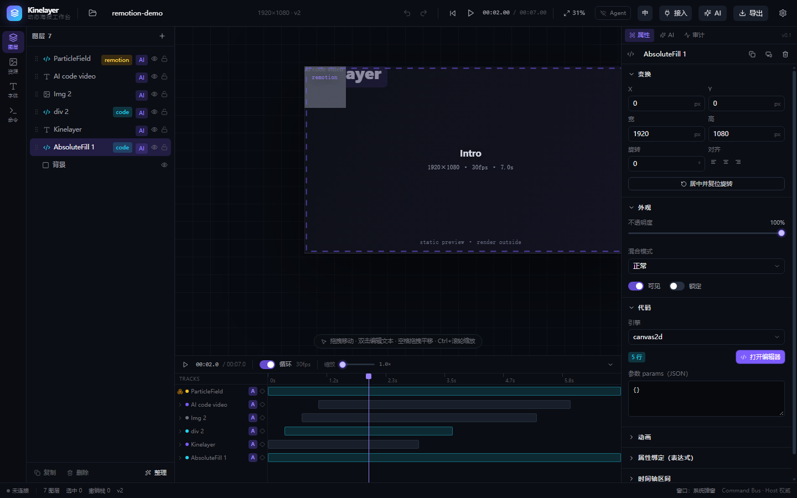
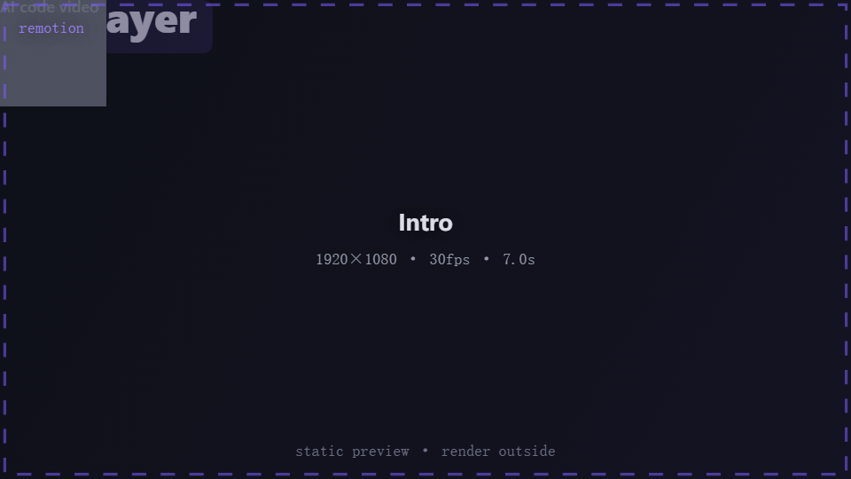

# 代码视频集成：从 AI 生成的 Remotion 工程到可编辑图层

> v2.5 的主线：**代码是一等公民图层**，但「能当图层」不等于「能当可编辑图层」。
> 这份文档说清楚三件事：能拆的怎么拆、拆不了的怎么留、留下的怎么拿出去出片。

## 一、三条底线

1. **不执行导入的代码**。Remotion / Manim / 任意 TSX 一律只读源码、只做静态分析。
   浏览器里跑不了 Node 渲染管线，硬跑只会得到「看起来成功」的假结果。
2. **不假装可编辑**。拆不出来的组件保留为 `remotion-component` 代码层：
   时间轴不展开它的内部关键帧，双击打开**只读**源码查看器，并写明「成片需在外部渲染」。
3. **降级必须记账**。每一处「丢了什么」都进 `ImportReport.notes`，界面上逐条展示，
   Agent 拿到的也是同一份（`renderNote()` 拼成中文；界面走 `t()` 按当前语言翻译）。

## 二、管线全景

```
ZIP ──► zipEntryNames()     只读中央目录，先判是不是 Remotion 工程
    ──► parseRemotionZip()  @babel/parser 静态 AST：Root → Composition → JSX 树
    ──► mapRemotion()       RemotionLayerSpec[] → 原生图层；leftovers → remotion-component
    ──► ai.importProject    落库（资源物化、换新 projectId、挂 origin 元信息）
    ──► ai.exportRemotionKit 把 remotion 那部分还原成可 `npx remotion render` 的工程
```

预检（`ai.inspectImport`）与正式导入走**同一个映射函数**，区别只是 `dryRun`：
报告里的数字就是导入后的数字，不存在「预览说 12 层、导进来 7 层」。

> 预检从 v2.5b 起是 `async` 的 —— 因为要动态 `import('@babel/parser')`（约 150KB gzip，
> 只有真的导入 Remotion 工程时才加载）。除了这一点，它仍然是纯函数：不读写 IndexedDB。

## 三、解析器能认什么

| 结构 | 结果 |
| --- | --- |
| `<Composition id width height fps durationInFrames component={X} />` | 画布尺寸、帧率、时长、入口组件名（多个取 `durationInFrames` 最长的那个） |
| `<Sequence from durationInFrames>` / `<Series.Sequence>` | 该子树内所有图层的时间范围 |
| `AbsoluteFill / div / section / …` 带 `backgroundColor` 或 `borderRadius` | 盒子层 → 生成 canvas2d 代码层（Kinelayer 没有原生形状层） |
| `<h1>/<p>/<span>/…` 或有纯文本子节点的元素 | 文本层（字号、粗细、颜色、对齐、行高、字距） |
| `//<Image src={staticFile('assets/x.png')}>` | 图片层 + 从 ZIP 里按后缀匹配出真实字节，写进资源库 |
| `interpolate(frame, [a,b], [x,y], {easing})` | 原生关键帧轨道（`x/y/opacity/rotation/fontSize/letterSpacing`） |
| `spring({frame, fps})` | 近似为 eased 0→1 的两帧，并**在报告里声明这是近似** |
| 自定义组件 `<ParticleField/>` | leftovers → `remotion-component` 代码层 |
| `<Audio>/<Video>/<OffthreadVideo>/<Gif>` | 跳过 + 记一条说明（Kinelayer 没有音轨，视频层不由 JSX 决定） |
| 三元 / `&&` / `.map()` 回调 | 结构按「分支并集」走一遍（并记说明），数据本身不猜 |

**不认的**：任何需要求值才能得到的东西 —— 变量拼出来的 `style`、运行时计算的坐标、
`useContext` 里的数据、`fetch` 返回值、循环里 `i * 20` 这种表达式。
`literalValue()` 只接受字面量、常量引用和四则运算，其余一律返回 `null` 并留说明。

## 四、`remotion-component` 层

```ts
interface RemotionRuntime {
  kind: 'remotion-component';
  entryCode: string;          // 组件源码，原样保存
  compositionId: string;
  durationInFrames: number;
  fps: number;
  width: number;
  height: number;
  previewMode: 'static-first-frame' | 'proxy-video';
  proxyAssetId?: string;      // 用户在外部渲过一遍的低码率预览
  reason?: string;            // 为什么没拆
  sources?: { path: string; code: string }[];  // 只挂在第一个 remotion 层上
}
```

渲染时走 `drawRemotionLayer()`：

- `proxy-video` → 画代理视频（走资源池，和普通视频层同一套解码/缓存）；
- 否则 `drawRemotionCard()` 画一张静态卡：渐变底 + 虚线框 + `remotion` 角标 +
  `compositionId` + `1920×1080 · 30fps · 7s` + `static preview · render outside`。

卡片上的字刻意用 ASCII 技术词，不进词典：它们是**内容标识**，不是界面文案，
翻译了反而认不出来。

`previewMode` 只影响编辑期观感，**不参与导出**。

### 为什么 layer 上还要存整棵源码树

只存被解析出来的那一个组件源码，导出 kit 后 `import './ParticleField'` 全会断。
所以导入时把原工程源码树挂到**第一个** remotion 层上（上限 600KB，超了就不存并记一条
「kit 只能导出解析出来的组件」）。这样 kit 能重建出可 render 的原工程。

## 五、remotion-kit 导出

```
remotion-kit/
├── package.json          只有 remotion / react / react-dom / @remotion/cli
├── README.md             出片命令 + 边界说明
├── src/index.ts          registerRoot(RemotionRoot)
├── src/Root.tsx          每个 remotion 层一个 <Composition>
├── src/layers/<Name>/entry.tsx   该层组件源码（缺 default export 时补一行）
├── src/original/**       原工程源码树（保持相对路径，import 不断）
└── public/assets/**      工程里还在用的媒体（basename 对齐 staticFile）
```

```bash
npm install
npx remotion render src/index.ts kly-01 out/kly-01.mp4
# 想还原完整原片（含已被拆成原生图层的部分）：
npx remotion render src/original/src/index.ts <原 Composition id> out/original.mp4
```

一条命令：`ai.exportRemotionKit`。返回 `files` / `compositions` / `hasOriginalTree` /
`skipped` / `missingAssets`，`download: true` 时同时触发下载。

**kit 里没有 Kinelayer 的关键帧**：那些层从没被当成可编辑轨道 —— 这正是「不假装能编辑」的意思。
kit 只负责 remotion 组件那部分；已拆成原生图层的文字/图片，请在 Kinelayer 里改和导出。

## 六、导入后长什么样



图层树里 `ParticleField` 挂 `remotion` 徽标（不是笼统的 `code`），时间轴上它是一个琥珀色圆点 +
一个方块图标 —— 没有展开箭头，因为**它内部没有可展开的关键帧**。下面那行 `Intro` 卡片就是它的预览。



纯画面（`query.capture` 离屏渲染）里能看到三件事：

1. `Kinelayer` 标题、`AI code video` 副标题、灰色 logo 方块都是**独立图层**，各自有 in/out 时间；
2. 紫色虚线框 + `remotion` 角标 + `static preview · render outside` 是那个组件层的占位卡；
3. **所有元素都堆在左上角** —— 这是这套方案最明显的短板：静态解析拿不到 flex/absolute 布局结果，
   只认 `style` 上的显式 `width/height` 与 `translate`。真要保留排版，请在外部 Remotion 出片，
   或者导入后手动摆一遍（位置是原生属性，能打关键帧）。

这条短板不打算用「猜布局」来补：猜错的排版比没有排版更难发现。

## 七、失败与降级矩阵

| 输入 | 预检 | 导入 |
| --- | --- | --- |
| ZIP 里没有 `.tsx/.ts/.js` | `supported:false`，说明「没有源码」 | 拦下 |
| 有源码但没有 `<Composition>` | `supported:false`，说明缺 id/width/fps 等 | 拦下 |
| Composition 有但一个元素都没解析出来 | `supported:false` | 拦下（不生成空壳工程） |
| 解析出元素 + 自定义组件 | `supported:true`，fidelity 按可编辑占比 | 原生层 + remotion 层 |
| 元素尺寸只写在 `style` 里（``） | 照 `style` 的显式 `width/height` 取值，`100%` 按父容器折算 | 盒子/图片层拿到正确尺寸 |
| `preserve-code` 模式 | 同上 | 整个 Composition 一个 remotion 层，不拆 |
| `.kly` 工程包 | `format: 'kly'` | 提示改用 `project.importBundle`（要走 sha256 校验） |

## 八、自检

```bash
npm run dev            # 另开一个终端，端口 5273
node scripts/remotion-check.mjs
```

37 条断言，覆盖：预检统计、Sequence 时间换算、interpolate/spring 轨道、
图片字节落到资源库、自定义组件降级、来源徽标（`remotion` + `AI`）、
`scene.ai.json` 的 remotion 元信息与「不含 base64」、
**kit 真的下下来 → Node 侧解包 → 每个 TSX 用 AST 验语法 → entry 有 default export**、
英文模式报告卡零中文。

kit 的「能出片」只在结构层面验证（语法合法 / import 路径存在 / README 命令正确）：
本机没有 Node 渲染环境，真跑 `npx remotion render` 需要用户在自己机器上执行。
