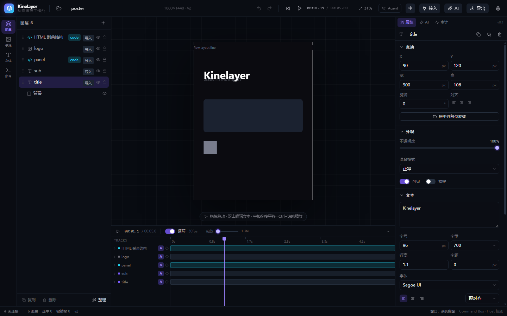

# HTML / GSAP 导入：从 AI 生成的网页片段到可编辑图层

> 对应阶段 **v2.5c**。上一篇 `04-code-video-integration.md` 讲的是 Remotion（代码视频），
> 这一篇讲另一条线：**一张网页** —— AI 生成的海报 HTML，动画用 GSAP 写。
> 两者的底线一样，但难点完全不同：Remotion 的难点是 AST，HTML 的难点是**布局**。

---

## 一、三条底线

1. **只解析，不执行。**
   `<script>` 里的内容只交给 `@babel/parser` 读 AST；HTML 用 `DOMParser` 建树、读 CSS 声明。
   不 eval、不 `new Function`、**也不把这段 HTML 塞进 iframe 去量真实布局**。
   编辑态确实有一个 iframe，但那是「已经导入之后」，属于视图层，不是解析阶段。

2. **不猜布局。**
   只认 `position: absolute | fixed` **且**写了 `left` / `top` 的元素 —— 它们的坐标是可读的。
   flex / grid / 普通流里的元素位置取决于字体度量与浏览器排版细节，静态算不出来，
   硬算出来的结果是「看着差不多、改起来全是错」，比不提取更坏。
   这类元素整块留进 leftover，报告里说明数量与原因。

3. **不承诺「导入任意网页 = 100% 可编辑」。**
   提取率、哪些没提出来、为什么 —— 全部写进降级报告。宁可少拆，也不让用户以为导进来的是原页。

---

## 二、管线全景

```
poster.html
   │
   ├─ DOMParser ─────────────► DOM 树
   │                              │
   │  <style> ──► CSS 规则表 ─────┤  element.matches() 逐条匹配
   │                              │  （文档顺序覆盖 + inline 最高，不实现 specificity）
   │                              ▼
   │                        每个元素的合成声明
   │                              │
   │        ┌─────────────────────┴─────────────────────┐
   │        │ position:absolute|fixed + left/top        │ 其它
   │        ▼                                           ▼
   │   原生图层（text / image / box）              leftover（原样保留）
   │        │                                           │
   │        │  元素从 DOM 里摘掉                          │
   │        ▼                                           ▼
   │   PropertyTrack ◄── GSAP AST                 html 代码层（完整文档）
   │                      (@babel/parser)                │
   │                                                    ▼
   └─────────────────────────────────────────► sandbox iframe + 桥接脚本
```

关键点：**提取走的元素会从 DOM 里删掉**，剩下的 `innerHTML` 才是 leftover。
不这么做的话，同一块内容会被画两遍（原生层一次、iframe 一次），视觉上重影。

---

## 三、解析器能认什么

### 3.1 DOM 与样式

| 情况 | 结果 |
| --- | --- |
| `position:absolute` + `left/top/width/height`（px 或 %） | ✅ 精确提取 |
| 尺寸写在 class 规则里（`.title{width:900px}`） | ✅ `element.matches` 匹配到，取用 |
| `width` 用 `em` / `rem` | ❌ 依赖字体度量，回落到内容估算并记 note |
| 尺寸缺失 | ⚠️ 按字号与字数估算，报告里写明估了多少 |
| 普通流 / flex / grid 里的元素 | ❌ 不猜，留 leftover |
| `` 即使不在绝对定位里 | ✅ 认（`src` 是硬信息，位置按画布左上角估并记 note） |
| `<canvas>` / `<svg>` / `<iframe>` / `<video>` | ❌ 没有对应原生图层，留 leftover 并点名 |
| `<script>` / `<style>` / `<meta>` / `<link>` | 跳过，不计入「流式跳过」 |
| `display:none` / `visibility:hidden` / `opacity:0` | 跳过（静态画面里本来就看不见） |
| `@media` / `@keyframes` | 跳过并记 note（`@media` 在固定画布下多半不触发；CSS 动画留给代码层原样跑） |

样式读取的实现是「**声明块合并**」，不是完整的 CSS 级联：
按文档顺序覆盖，inline style 最后覆盖。不处理 `!important`、不处理 specificity、
不处理继承（除了显式写在自己身上的声明）。这是刻意的 ——
半套级联比没有更容易骗人，报告里写清就够了。

### 3.2 字形

| 属性 | 取值 |
| --- | --- |
| `font-size` | px / % |
| `font-weight` | `bold` → 700，`normal` → 400，数字原样 |
| `line-height` | 无单位倍数原样；px 折算成倍数 |
| `letter-spacing` | px |
| `color` | 任意 CSS 颜色（Canvas `fillStyle` 能吃） |
| `text-align` | left / center / right |
| `border-radius` | 单值 px，或 `50%`（折算成短边一半） |

### 3.3 GSAP

只认这四种调用形状，其余一律记 note 跳过：

```js
gsap.to('.a',   { x: 100, duration: 1 })          // 从原位动到目标位移
gsap.from('#b', { opacity: 0, duration: .5 })     // 从目标值回到原位
gsap.fromTo('.c', { x: 0 }, { x: 200 })           // 起终点都给定
const tl = gsap.timeline(); tl.to('.d', {...})    // timeline 顺序累加
gsap.timeline().to('.e', {...}).to('.f', {...})   // 链式
```

**`x` / `y` 是 transform 位移，不是绝对坐标。** 这条最容易错：
`gsap.to(el, { y: 140 })` 意思是「在元素当前位置再往下 140」，所以图层的 `y` 应该是
`原位 + 140`。第一版直接拿 140 当终点，画面上所有动画元素都跳到画布左上角附近。

| GSAP 属性 | 落到哪条轨道 |
| --- | --- |
| `x` / `left` / `translateX` | `x`（叠上图层原位） |
| `y` / `top` / `translateY` | `y`（叠上图层原位） |
| `opacity` / `autoAlpha` | `opacity` |
| `rotation` / `rotate` / `rotationZ` | `rotation` |
| `width` / `height` | `width` / `height` |
| `scale` / `scaleX` / `scaleY` / 颜色 / 滤镜 | 没有对应轨道，记 note 跳过 |
| `x: '+=100'` / `x: () => ...` | 静态读不出终点，记 note 跳过 |
| timeline 的 `'-=0.5'` / `'<+'` 位置参数 | 读不出绝对时间，按顺序累加并记 note |

### 3.4 selector → 图层

提取时把元素的 `id` 或首个 `class` 存进图层名（`.title` → `title`），
GSAP 的 selector 按 `#title` / `.title` / `title` 依次去对。

对不上的不会硬塞给第一个图层 —— 那会画出用户没写过的动画。报告里列出前几个没对上的 selector。

---

## 四、`html` 代码层与时间同步

### 4.1 leftover 为什么是完整文档

第一版只取了 `body.innerHTML`，两个后果都很难看：

- `<style>` 在 `<head>` 里，没跟过来 → 所有 class 规则失效，元素回到浏览器默认样式
- iframe 默认白底铺满画布 → 把已经摆好的原生图层全盖住，截图一片白

所以 leftover 现在是一个**完整 HTML 文档**：原 `<style>` 原样带上、body 的属性带上、
末尾补一条重置。

### 4.2 iframe 白底：Chrome 里去不掉

`sandbox="allow-scripts"` 的 iframe 即使把 `html, body` 写成 `background: transparent !important`，
**Chrome 仍然画白底**。实测过四个变体（默认 / 文档透明 / 文档透明 + iframe 元素透明 /
透明 + `color-scheme:normal`），全部是白的。

所以换个方向，两条一起做：

1. **重置里的背景色 = 画布底色**（从 body 的 `background` 读出来），iframe 看起来跟画布是同一块
2. **把 iframe 收缩到内容包围盒** —— 桥接脚本量出所有可见元素的矩形并集，把自己整块
   `translate(-x, -y)`，把 `{x,y,w,h}` 回传给宿主，宿主按这个盒子摆 iframe

结果：一行流式文本 → iframe 只有 `1080×40`，最多挡住那一行，不会把整张画布糊掉。

包围盒是在 `DOMContentLoaded` + `load` 时上报的，但**宿主可能还没装好监听**（竞态），
所以 iframe 的 `onLoad` 里会主动发一条 `measure` 让 bridge 重测一次。
竞态的表现是「偶发地 iframe 铺满画布」—— 自检连跑三次抓出来的。

### 4.3 时间同步协议

iframe 里的 GSAP / CSS 动画默认按**真实时间**自己跑，跟主时间轴毫无关系。
桥接脚本干三件事：

1. 一加载就冻结：`gsap.globalTimeline.pause()` + `document.getAnimations().forEach(pause)`
   - 冻结要持续 ~5 秒（`setInterval` 每 16ms 一次）：gsap 可能来自 CDN，比桥接脚本晚到
2. 收到 `{ kly: <token>, type: 'time', ms }` 就 seek
   - 有 gsap 走 `globalTimeline.time(ms/1000)`
   - 没有就走 Web Animations API：`anim.getAnimations().forEach(a => a.currentTime = ms)`
3. 就绪后发 `{ kly, type: 'ready' }`，宿主收到立刻补推一次当前播放头

宿主侧在 Stage 的 rAF 循环里推时间，按整毫秒判重（播放头是 float，逐帧比会把消息量翻倍而画面没区别）。

### 4.4 为什么不用 `event.origin` 校验

**这个 iframe 没有 `allow-same-origin`，它的 `event.origin` 恒为 `"null"`。**
任何沙箱 iframe 发来的消息都是 `"null"` —— 拿 origin 判断「谁发的」在这里等于没判断。

真正可靠的两条：

- **宿主侧**：`event.source === iframe.contentWindow`（只认自己那几个 iframe）
- **iframe 侧**：消息里的 `kly` token 必须等于自己那份（每层一个，从图层 id 派生）

---

## 五、origin 元信息

每层的 `origin` 除了原有的 `generator` / `sourceFormat` / `sourceBundle` / `importedAt`，
v2.5c 加了两个字段，v2.6 又补了一个：

| 字段 | 含义 |
| --- | --- |
| `parser` | 解析这条来源用的规则版本（`html-dom/1`）。规则会变，留着它才能分辨「旧规则猜的」还是「新规则也没救」 |
| `external` | 导入时发现的远程依赖（GSAP CDN、远程字体/图片）。编辑态能加载，**导出与离线打开会缺** |
| `sourceRef` | 这一层在原 HTML 里指向的地址（`` 原文）。**只在那个引用没被落地成资源时写** |

`sourceRef` 是给「报告关掉之后」用的：远程与相对路径的图都不替用户抓，
导入后靠它回答「我原本要的那张图在哪」。完整机制见
[`06-after-import.md`](06-after-import.md)。

`sourceFormat` 记成 `gsap` 还是 `html`，看有没有真提取到动画 —— 记错会误导「这层到底有没有时间信息」。

---

## 六、导入后长什么样



样例是一份 1080×1440 的海报：`h1#title` / `p#sub` / `div#panel` / `img#logo` 四个绝对定位元素
加一行流式文本，动画是 `timeline` 两条 + 一条带 delay 的 `from`。

- 图层树 6 层：背景、title、sub、panel（canvas2d 盒子）、logo（图片）、HTML 剩余结构（html 代码层）
- 时间轴 5 条轨道：`y`（标题位移）、`opacity`（副标题淡出）、`x`（logo 入场）
- 截图停在 1.2s：标题已经下移、副标题正在淡出 —— 轨道真的在驱动画面
- 顶上那条极窄的带子是 leftover iframe（1080×40），背景色跟画布一致，看不出边界

---

## 七、失败与降级矩阵

| 输入 | 结果 |
| --- | --- |
| 纯绝对定位、无 GSAP | 全部变原生图层，`fidelity` 高 |
| 有 GSAP、选择器能对上图层 | 原生图层 + 原生轨道 |
| GSAP 选择器对不上（如 `'.card .inner'`） | 图层保留，轨道不建，报告列出 selector |
| 整页 flex / grid | 0 个原生图层，整份进 html 代码层，报告写明「流式布局 N 个元素留在代码层」 |
| 有 `<canvas>` 主视觉 | 提不出来，留 leftover 并点名 `<canvas>` |
| 图片是远程 URL | 变图片层但 `assetId` 为空，进 `missingAssets`，报告提示重新指定 |
| HTML 为空 / 超 2MB | `HtmlParseError`，报告给出原因，不静默退回代码层 |
| `preserve-code` 模式 | 不拆，整份一个 html 代码层 |

---

## 八、自检

```bash
# 需要 dev server 跑在 5273
npm run dev            # 另一个终端
node scripts/html-check.mjs
```

**43 项**，分八组：

1. 预检：格式 / 统计 / 画布尺寸 / 时长 / 三类 note
2. 导入：每层的类型、位置、字号、颜色、宽度
3. GSAP 轨道：三条 tween 的时间与值（含 `x`/`y` 叠原位的语义）
4. origin：`sourceFormat` / `parser` / `external`
5. 编辑器：iframe 数量 / sandbox 属性 / 桥接注入 / token / 收缩后的尺寸
6. 桥接脚本：假 window 里跑一遍（token 校验、seek 到点、幂等注入、插入位置）
7. 词条覆盖：静态扫 `htmlImport.ts` + `importPipeline.ts` 里的中文 key，逐条查 `en.ts`
8. 英文模式：真的选一个 .html 文件导入，看报告卡里有没有汉字

第 6 组值得说一下：桥接脚本是注入到 iframe 里的一段 ES5 字符串，
在浏览器里很难断言（跨源读不到内部状态）。所以用 `new Function` 在一个假 `window` /
`document` / `parent` 里跑一遍 —— 比在真 iframe 里测更准，也不用给生产代码加测试钩子。
